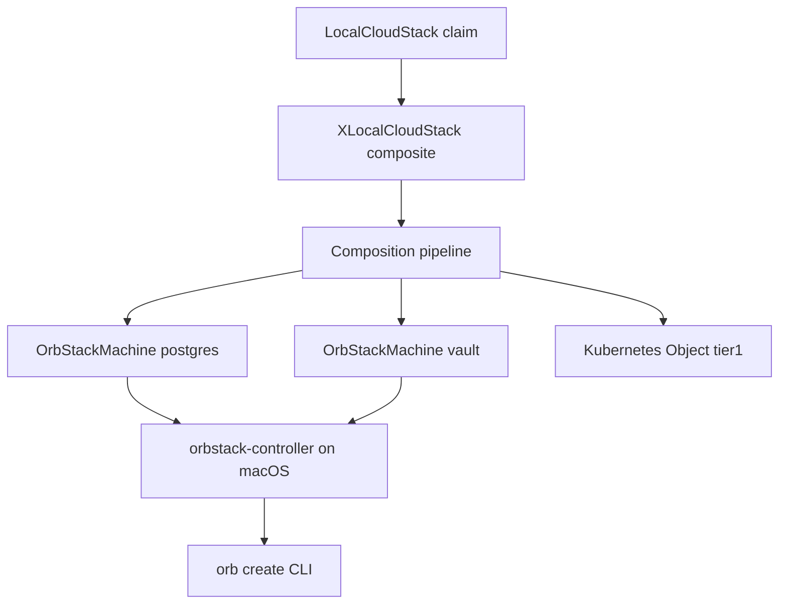

# Crossplane on OrbStack Kubernetes

## Install Crossplane

```bash
helm repo add crossplane-stable https://charts.crossplane.io/stable
helm upgrade --install crossplane crossplane-stable/crossplane \
  --namespace crossplane-system --create-namespace \
  --set args='{"--enable-composition-functions"}'
```

Install the patch-and-transform composition function:

```bash
kubectl apply -f crossplane/install/function-patch-and-transform.yaml
kubectl wait --for=condition=Healthy function/function-patch-and-transform --timeout=180s
```

Optional: [provider-kubernetes](https://marketplace.upbound.io/providers/upbound/provider-kubernetes) for composing in-cluster objects:

```bash
kubectl apply -f crossplane/install/provider-kubernetes.yaml
```

## Apply this repo

```bash
kubectl apply -k crossplane/install/crd
kubectl apply -k crossplane/install/xrd
kubectl wait --for condition=Established crd/xorbstackmachines.cloud.orbstack.io --timeout=120s
kubectl wait --for condition=Established crd/xlocalcloudstacks.cloud.orbstack.io --timeout=120s
kubectl apply -k crossplane/compositions
kubectl apply -f crossplane/examples/claim-local-cloud.yaml
kubectl apply -k tier1
```

## Model



Claims live in the cluster; **machine provisioning** runs on the Mac host where
`orb` exists (controller out-of-cluster). A future **Provider OrbStack** can move
reconciliation into the cluster via a privileged DaemonSet.
