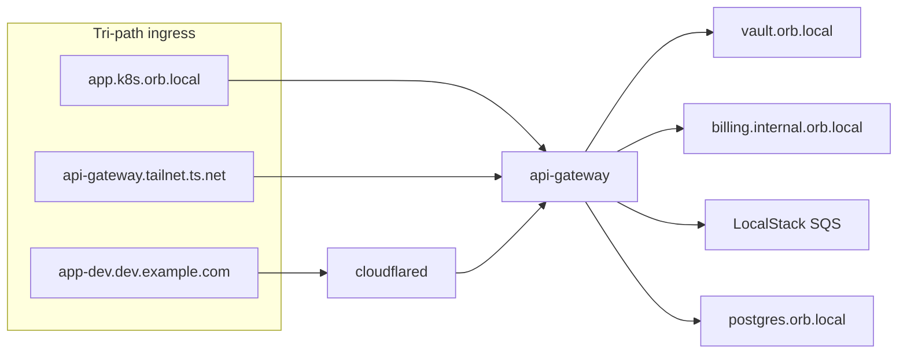

# Crossplane on OrbStack Kubernetes

Issue #5 Story **7.1**: Crossplane is the universal IaC control plane (Terraform-free).

## Install Crossplane

```bash
helm repo add crossplane-stable https://charts.crossplane.io/stable
helm upgrade --install crossplane crossplane-stable/crossplane \
  --namespace crossplane-system --create-namespace \
  --set args='{"--enable-composition-functions"}'
```

```bash
kubectl apply -f crossplane/install/function-patch-and-transform.yaml
kubectl wait --for=condition=Healthy function/function-patch-and-transform --timeout=180s
```

## Providers (issue #5 Story 7.1)

| Provider | Purpose | Install stub |
| --- | --- | --- |
| **function-patch-and-transform** | OrbStack XRD compositions | `function-patch-and-transform.yaml` |
| **provider-kubernetes** | Tier 1, Tailscale Operator, cloudflared pods | `provider-kubernetes.yaml` |
| **provider-helm** | Install Operator / cloudflared via chart | `provider-helm.yaml` |
| **provider-upjet-aws** | S3/SQS on LocalStack (`s3.aws.orb.local:4566`) | `provider-upjet-aws-localstack.yaml` |
| **provider-cloudflare** | DNS, Tunnel resources | `provider-cloudflare.yaml` |
| **Host orbstack-controller** | `OrbStackMachine` → `orb create` (Epic 4.2 bridge interim) | `packages/orbstack-controller` |

### LocalStack ProviderConfig (sketch)

Point AWS API at Compose LocalStack endpoints; use path-style S3 and skip credential validation.
Details: issue #5 Story 7.3 (`XEventBus` → `billing-events` queue, `invoices-archive` bucket).

## Custom XRDs (repo naming)

| Plan (#5) | Repo |
| --- | --- |
| `XOrbMachine` | `XOrbStackMachine` |
| `OrbMachineClaim` | `OrbStackMachineClaim` |
| `XCloudflareEdgeIngress` | Planned (Story 7.4) |
| `XEventBus` | Planned (Story 7.3) |

## Apply Phase 1 stack

```bash
kubectl apply -k crossplane/install/crd
kubectl apply -k crossplane/install/xrd
kubectl apply -k crossplane/compositions
kubectl apply -f crossplane/examples/tier3-stateful-claims.yaml
kubectl apply -k tier1
cd packages/orbstack-controller && bun install && bun run start
```

## Target reconciliation flow (Story 7.4 E2E)



See [EXECUTION_PLAN.md](./EXECUTION_PLAN.md) §6 NFR gates.
