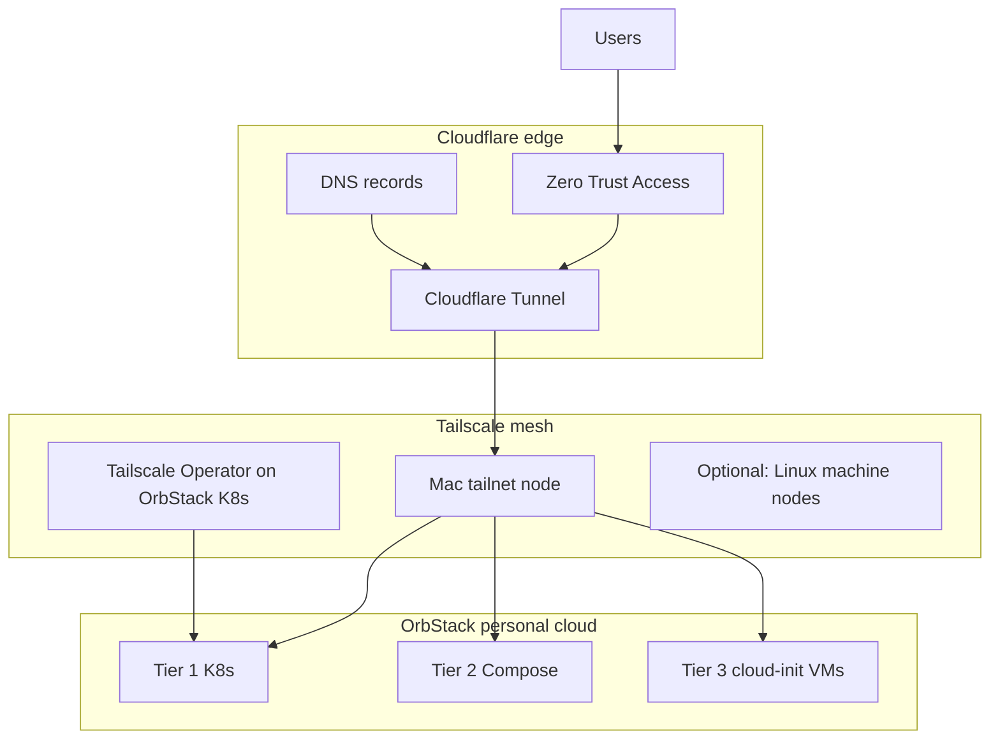

# Planning — Crossplane, Tailscale, Cloudflare (no Terraform)

This repo implements Track B from [issue #2](https://github.com/lornu-ai/orb-stack-cloud/issues/2) with a **three-pillar control plane** instead of Terraform/OpenTofu, Ansible modules, or ad-hoc scripts.

| Pillar | Role in personal / local cloud | Replaces (from original backlog) |
|--------|--------------------------------|----------------------------------|
| **Crossplane** | Declarative SoT: K8s workloads, Compositions, and (planned) Cloudflare + Tailscale managed resources | Terraform/OpenTofu modules, remote-exec provisioners, hand-maintained YAML drift |
| **Tailscale** | Private mesh: Mac ↔ OrbStack ↔ edge nodes; MagicDNS; K8s **Tailscale Operator** for stable private names | VPN port-forwards, brittle `ssh`/`ansible` inventory, exposing Postgres/Vault on LAN |
| **Cloudflare** | Public edge: DNS, **Tunnel** (`cloudflared`), Zero Trust **Access** for human/API ingress | Terraform CF provider-only stacks, `localhost` tunnels, unmanaged apex records |

OrbStack **`*.orb.local`** DNS remains the **on-box** data plane (issue #1). Tailscale and Cloudflare extend reach **off the Mac** without replacing OrbStack networking.

## Layered topology

## Responsibility split

### Crossplane

- **Today:** `LocalCloudBlueprintClaim` + `provider-kubernetes` → Tier 1 (gateway, auth, Ingress).
- **Phase 2:** Compositions under `crossplane/edge/cloudflare/` (DNS, Tunnel, Access apps) using org-standard **provider-cloudflare** (Upjet), secrets via ESO — same pattern as `infra-code` / `crossplane/cloudflare/`.
- **Phase 2:** Compositions under `crossplane/edge/tailscale/` (Connector, DNSConfig, proxy classes) aligned with `tailscale-mesh` operator patterns.
- **Tier 3:** Still **`orb create -c`** for Linux machines; Crossplane publishes cloud-init and records desired hostnames — not a Terraform `orb` provider.

### Tailscale

- Every developer Mac joins the **tailnet**; OrbStack services are reached via **MagicDNS** (e.g. `spark-bde7`) or **Tailscale Serve/Funnel** where appropriate.
- **Tailscale Kubernetes Operator** on the integrated cluster exposes Tier 1 Services as tailnet names (e.g. `app.orbstack-dev.<tailnet>.ts.net`) for remote teammates and CI runners on the mesh.
- Tier 3 Postgres/Vault: **tailnet-only** listeners; no public IPs. Cross-tier tests from K8s use tailnet routes or OrbStack bridge when on the same Mac.

### Cloudflare

- **Developer-facing hostname** (optional): `app.<env>.<your-zone>` → Tunnel → `cloudflared` on Mac or in-cluster → Tier 1 Ingress / Tier 2 labels.
- **Zero Trust Access** in front of checkout/admin paths (Story 7.3 hardening) — policy as Crossplane resources, API token from ESO.
- **DNS** for any public demo apex is declarative Crossplane, not Terraform state buckets.

## Phased delivery

| Phase | Outcome | Primary tools |
|-------|---------|---------------|
| **P0** (current) | Epic 7 three-tier on Mac; Crossplane Tier 1; cloud-init Tier 3 | Crossplane + OrbStack |
| **P1** | Tailscale Operator + tailnet DNS for Tier 1; document mesh validation | Tailscale + Crossplane (K8s) |
| **P2** | Cloudflare Tunnel + Access for selected hostnames; DNS records in Crossplane | Cloudflare + Crossplane |
| **P3** | Epic 8 isolation: Access policies, tailnet ACLs, no `:latest`, digest-pinned images | All three |

## Explicit non-goals

- **No Terraform / OpenTofu** in this repo or recommended path for Epic 7–8.
- **No Docker daemon build plane** for fleet images (org Nix/dockworker applies when publishing services).
- **Track A** (OrbStack engine) unchanged — still product code.

## References

- [IAC.md](IAC.md) — Terraform → Crossplane mapping (Story 7.1)
- [EDGE-NETWORK.md](EDGE-NETWORK.md) — Tailscale + Cloudflare detail
- [ARCHITECTURE.md](ARCHITECTURE.md) — tier topology
- Org: `code-governance` FR_TAILSCALE_OPERATOR_MULTICLOUD_MESH, Cloudflare via Crossplane in `infra-code`
